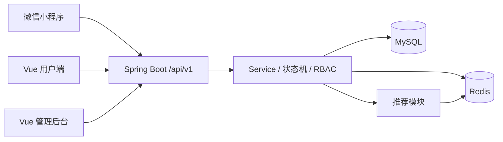

# 软件工程校园搭子平台项目

帮助学生在拼饭、自习、运动、竞赛等临时场景里快速找到同行者。用户用不到一分钟发布带类型、时间、地点和人数上限的搭子活动；系统用列表筛选与可解释推荐把活动送到合适的人面前，再用信用分约束爽约。

**当前状态：设计阶段。** 课程强调从想法到规划的全过程，编码放在后面。本仓库是小组唯一仓库：现在提交文档，实现开始后 **代码也在这里提 Pull Request**。六人、十周、四名后端 + 两名前端。

## 从这里开始

| 你要做什么 | 入口 |
| --- | --- |
| 看全过程怎么排 | [过程、可行性与风险](docs/15-process-feasibility-risk.md) |
| 看产品要解决什么 | [愿景与范围](docs/01-vision-and-scope.md)、[PRD](docs/02-prd.md) |
| 看市场、竞品与是否值得做 | [市场调研](docs/06-market-research.md)、[经济分析](docs/07-economic-analysis.md) |
| 看上大工号怎么登录、验证码怎么申请 | [校园身份](docs/16-campus-identity.md) |
| 看十周怎么交付 | [开发大纲](docs/10-baseline-and-batches.md)、[六人分工](docs/05-team-and-modules.md)、[按周任务板](docs/17-weekly-board.md) |
| 实现接口（Agent 先读） | [OpenAPI 真源](contracts/openapi.yaml)、[Agent 契约](contracts/AGENT_CONTRACT.md)、[总体 TRD](docs/03-trd.md)、[接口说明](docs/04-api-contract.md)、[数据模型](docs/11-data-model.md) |
| 领取模块 | [A 用户鉴权](docs/trd/a-auth.md)、[B 活动报名](docs/trd/b-activity.md)、[C 推荐](docs/trd/c-reco.md)、[D 信用运营](docs/trd/d-credit-ops.md)、[E 小程序](docs/trd/e-miniprogram.md)、[F Web](docs/trd/f-web.md) |
| 落地：扫码预览或备案域名 | [部署说明](docs/13-deployment.md)、[开发环境](docs/18-dev-environment.md) |
| 提交与联调 | [工程规范](docs/08-engineering-standards.md)、[GitHub 协作](docs/09-github-collaboration.md) |
| 填姓名与账号 | [人员表模板](docs/team/team-signup-template.csv)；填完的表不要提交公开仓库 |

## 架构



小程序和网页连同一后端。一般答辩用开发者工具扫码 + 浏览器打开网页；有域名并完成备案后，小程序再走正式注册发布。详见部署说明。

密钥、问卷回执和真实用户数据不要进 Git。**不要按人名建交代码文件夹。** 目录约定：

```
contracts/          字段真源 OpenAPI + 正反例
backend/            一个 Spring Boot：auth(A) activity(B) reco(C) credit(D)
miniprogram/        E
web/                F portal + admin
deploy/             F Compose
docs/17-weekly-board.md  每人每周任务
```

接口以 OpenAPI 为准。队友用分支 + PR 合入 `main`，不要直推。本地环境见 [18](docs/18-dev-environment.md)。

## 十周主线

注册/登录 → 发布活动 → 审核与敏感词 → 列表筛选与推荐 → 报名不超员 → 成团与提醒 → 到场/签到写入信用分 → 后台审核与看板。

不做支付、即时通讯、校园卡对接、跨校和大模型。推荐用可解释加权打分，UserCF 为亮点可加深。
