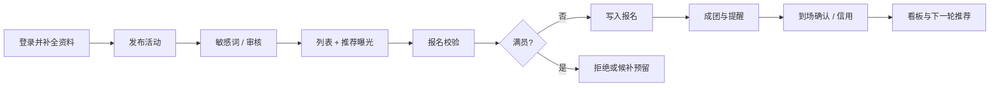

# 内部 PRD v1.0｜CampusBuddy（十周）

状态：**方案/仓库骨架，尚未实现。** 产品范围以本文与 [愿景](01-vision-and-scope.md) 为准；接口以 [契约](04-api-contract.md) 为准。展示层为 **微信小程序 + Vue 3 Web 用户端 + Vue 3 管理后台**，后端统一 REST。

## 用户与核心任务

学生打开小程序或 Web，用上大学号/工号登录（首次用学校邮箱验证码，之后用本平台密码），补全学院、年级、常驻校区和 3–10 个兴趣标签。小程序可用微信预览，但报名和发布必须已绑定学号。发起人填写类型、时间、校区/地点、人数上下限、截止时间后发布；敏感词拦截，抽检审核通过后进入曝光池。参与者按时间/校区/类型筛选，或从推荐流进入详情，三步内报名。系统在报名瞬间校验状态、截止、名额、时间冲突、信用、黑名单。达到人数下限则成团并通知。活动结束后发起人确认到场名单，结果写入信用流水。管理员在后台审核、处理举报、调整推荐权重、查看看板。

没有真实校园投放时，演示用造数账号走通闭环，并在界面或文档标明演示数据。

## 页面与用户流程

小程序是主入口：首页推荐流、分类列表、搜索筛选、详情、分步发布、我的报名/我的发布、消息、个人中心。Web 用户端侧重桌面检索与详情，不另做一套业务。管理后台独立路由：待审队列、用户与黑名单、举报申诉、参数配置、数据看板、操作日志。

关键状态（余量、截止、信用档、推荐理由）必须出现在列表卡片上。失败提示必须可执行，禁止只返回“操作失败”。游客可看公开列表，报名与联系方式需登录。

## 范围和验收

| 优先级 | 功能 | 可见验收 |
| --- | --- | --- |
| P0 | 学号/工号登录、学校邮箱验证码、JWT、RBAC | 越权 403；过期 401；口令 BCrypt；非上大邮箱域拒发码 |
| P0 | 发布活动并校验时间地点人数 | 缺必填不可提交；开始时间至少 +30 分钟 |
| P0 | 列表筛选与详情 | 服务端过滤；P95 目标 300ms |
| P0 | 报名不超员、时间冲突拦截 | 并发测试不超员；冲突返回活动标题 |
| P0 | 成团与状态机 | 达下限成团；定时任务驱动进行中/已结束 |
| P0 | 敏感词、审核、举报 | 命中拒发留痕；24 小时处理时限写入工单 |
| P0 | 个性化推荐流（可降级热度榜） | 只出报名中且未报满；附理由或降级标记 |
| P1 | 信用加扣分、限制、申诉 | 流水只追加；低于 60 禁发布、低于 40 禁报名 |
| P1 | 站内消息 + 订阅消息降级 | 通知失败不影响报名事务 |
| P1 | 到场确认 | 24 小时未确认则默认全部到场 |
| P1 | 看板六项核心指标 | 口径与统计视图一致，禁止前端临时估算 |
| P1 | 候补递补、扫码签到 | 满员进候补；取消后自动递补；签到接口可演示 |
| P2 | 周期性活动、置顶、名单导出、反向找人 | 第 8 周末未启动则移出 |
| 非目标 | 支付、IM、跨校、大模型、闸机、持续定位 | 无对应接口 |

## 产品约束

- 业务规则只在服务端。前端倒计时、余量展示只是提示，以接口返回为准。
- 信用分区间 0–100，初始 100；改分只能走流水。申诉冲正写反向流水，原始记录不删。
- 推荐权重可在后台修改且和为 1；Redis 不可用时降级为热度排序，响应带 `degraded=true`。
- 位置默认“校区 + 楼栋/场所”枚举，不采集持续定位。地理因子用枚举距离，不用真实轨迹。
- 候补：满员写入 `WAITLIST`，有人取消则按顺序递补。
- 个人信息最小化。展示脱敏。平台不承担线下活动安全责任，详情页展示免责声明。
