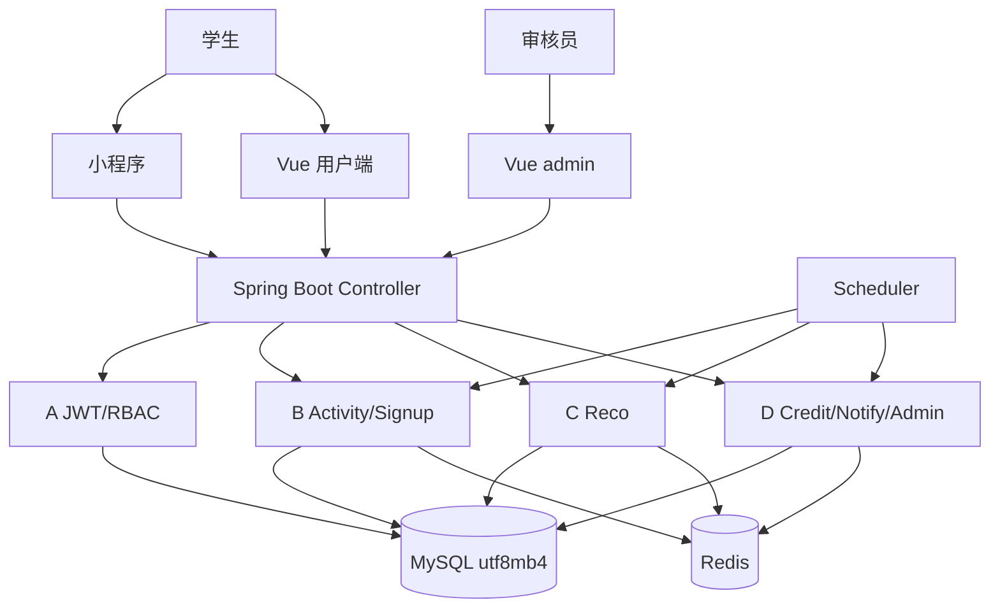
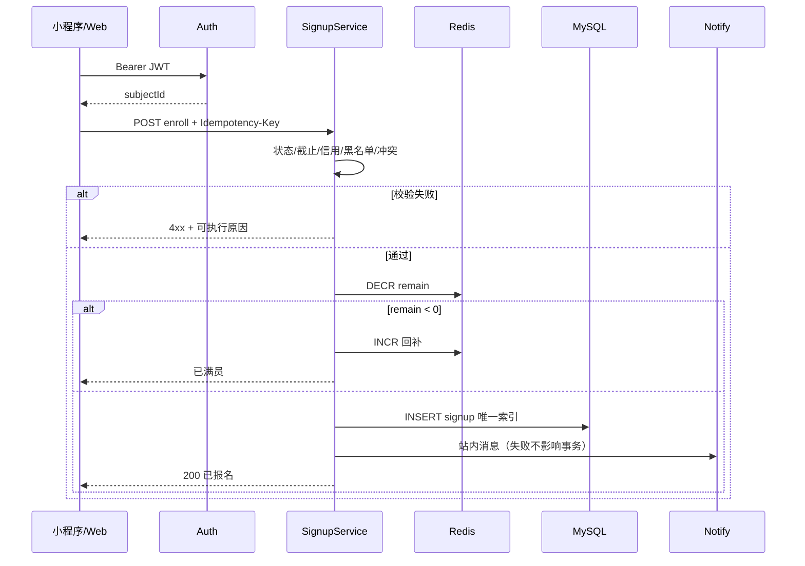

# 总体 TRD v1.0｜CampusBuddy

| 项 | 基线 |
| --- | --- |
| 状态 | 可执行设计与接口约定；服务尚未实现 |
| 产品 | [PRD](02-prd.md)、[愿景](01-vision-and-scope.md) |
| 技术 | 小程序原生/Vant；Vue 3/Vite/Pinia/Element Plus/ECharts；JDK 17/Spring Boot 3/MyBatis-Plus/MySQL 8/Redis 7 |
| 字段真源 | [接口契约](04-api-contract.md) |
| 数据真源 | [数据模型](11-data-model.md) |
| 实现安排 | [开发大纲](10-baseline-and-batches.md)、[A–F 子 TRD](05-team-and-modules.md) |
| 代码与协作 | [工程规范](08-engineering-standards.md)、[协作规范](09-github-collaboration.md) |

## 1. 范围与所有权

B 拥有活动对象、报名、候补、签到与时间冲突规则。A 拥有身份、会话、角色。C 拥有推荐流水线与推荐配置接口。D 拥有信用、通知、敏感词、审核/用户/看板接口和 Redis 约定。E/F 只消费 DTO，不重算余量、信用或推荐分。

首版本校、单机 Docker Compose、日均活动假设 ≤200。不做微服务、消息队列、分库分表。不做支付。小程序个人主体下订阅消息失败则站内信兜底。

## 2. 结构与部署

默认本地：Web 5173、Admin 5174、后端 8080、MySQL 3306、Redis 6379。浏览器不直连 Redis/MySQL。小程序与网页共用该 API。没有独立推荐进程，推荐是后端模块，必须能降级为热度榜。三种打开方式（开发者工具扫码、网页 IP/域名、备案后小程序正式版）见 [落地部署](13-deployment.md)。

## 3. 关键规则落点

| 规则 | 实现位置 | 禁止 |
| --- | --- | --- |
| 报名超员与候补 | B：Redis DECR + 唯一索引；满员 WAITLIST | 只靠前端 disabled |
| 时间冲突 | B：同一用户开始时间差 < 60 分钟 | C 用推荐分代替冲突 |
| 活动状态迁移 | B：状态机 + 每分钟扫描 | 前端直接改 status |
| 信用加扣 | D：只追加 `t_credit_record` | `UPDATE t_user.credit_score` 不写流水 |
| 敏感词 | D：写入路径前置 | 先入库再扫 |
| 推荐降级 | C：三级降级 | 异常时返回空当成功 |
| 审核生效 | D 写状态，B 列表只读已发布 | 后台改库绕过接口 |

## 4. 报名时序

同一幂等键内容相同则返回首次结果；内容不同返回 409。执行中同键返回 409 `REQUEST_IN_PROGRESS`。

## 5. 非功能与故障

查询目标是本地或单机云可演示，不把未实测 P95 写成已达标。报名失败事务回滚。推荐超时或 Redis 失败走热度榜，不让首页白屏。

日志允许：timestamp、level、requestId、userId 哈希、path、status、durationMs。禁止验证码、JWT、完整手机号/学号、SQL 明文参数中的隐私字段。

配置项：成员 GitHub、校区枚举、微信 AppId（没有则学号 + 本平台密码登录）、SMTP。密钥只进环境变量。不收集学校统一认证密码。
