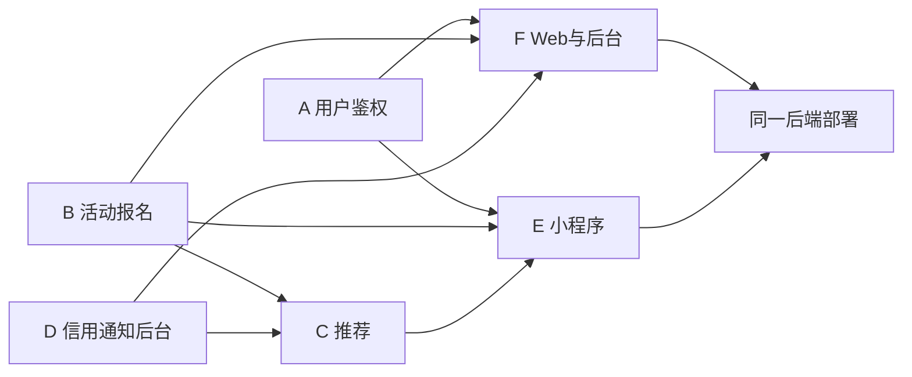

# 六人分工

六人：四名后端、两名前端。Web 端和小程序端共用同一套后端接口。分工与课程开发方案一致：一人主导一块，跨端互相 backup，文档责任到人。姓名组内填写。

| 成员 | 角色 | 主要负责内容 | 预估代码量 |
| --- | --- | --- | --- |
| A | 项目经理 / 后端 | 项目计划、需求分析；后端用户、学号登录与邮箱验证码、RBAC、个人主页 | 1500 行 + 需求文档 |
| B | 后端开发 | 活动发布与检索、报名状态机、候补递补、签到、收藏 | 1700 行 + 数据库设计文档 |
| C | 算法 / 后端开发 | 智能推荐：召回、打分、UserCF、离线特征、埋点、推荐配置接口 | 1800 行 + 推荐算法设计说明 |
| D | 后端开发 | 信用体系、消息通知与定时任务、举报风控、敏感词、管理后台统计接口、Redis | 1600 行 + 接口文档（Knife4j） |
| E | 小程序前端 | 小程序全部页面：首页推荐流、列表、详情、发布、报名、消息、我的 | 2400 行 |
| F | Web 前端 / 测试 | Web 用户端与管理后台、ECharts 看板；测试用例、部署文档、演示视频 | 2800 行 + 测试文档 |

合计目标约 10800–14600 行有效代码，满足课程不低于 10000 行。后端四人维护同一个 Spring Boot 工程，按模块分包，不要拆成四个服务。

子 TRD：[A](trd/a-auth.md) · [B](trd/b-activity.md) · [C](trd/c-reco.md) · [D](trd/d-credit-ops.md) · [E](trd/e-miniprogram.md) · [F](trd/f-web.md)

接口变更先改 [契约](04-api-contract.md)。E 与 F 不得在前端实现名额、信用或推荐分。C 不写报名锁。部署见 [落地部署](13-deployment.md)。
