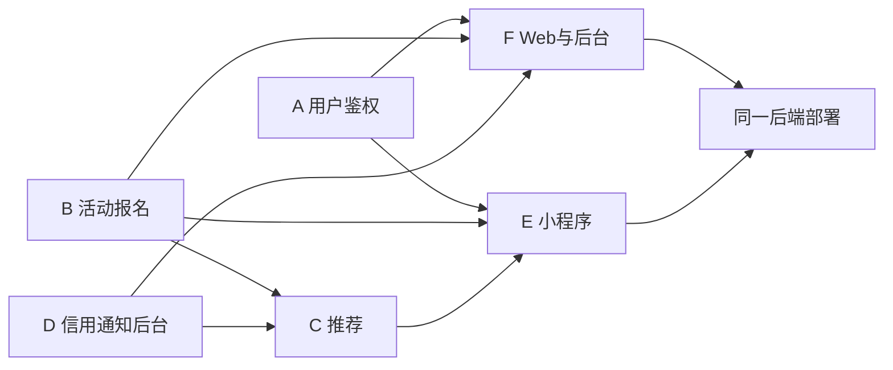

# 六人分工

六人：四名后端、两名前端。Web 端和小程序端共用同一套后端接口。分工与课程开发方案一致：一人主导一块，跨端互相 backup，文档责任到人。姓名组内填写。

| 成员 | 角色 | 主要负责内容 | 预估代码量 |
| --- | --- | --- | --- |
| A | 项目经理 / 后端 | 项目计划、需求分析；用户表、学号/工号登录、**上大邮箱验证码**、本平台密码、JWT/RBAC、个人主页 | 1500 行 + 需求文档 |
| B | 后端开发 | 活动发布与检索、报名状态机、候补递补、签到、收藏 | 1700 行 + 数据库设计文档 |
| C | 算法 / 后端开发 | 智能推荐：召回、打分、UserCF、离线特征、埋点、推荐配置接口 | 1800 行 + 推荐算法设计说明 |
| D | 后端开发 | 信用体系、消息通知与定时任务、举报风控、敏感词、管理后台统计接口、Redis | 1600 行 + 接口文档（Knife4j） |
| E | 小程序前端 | 小程序全部页面：首页推荐流、列表、详情、发布、报名、消息、我的 | 2400 行 |
| F | Web 前端 / 测试 | Web 用户端与管理后台、ECharts 看板；测试用例、部署文档、演示视频 | 2800 行 + 测试文档 |

合计目标约 10800–14600 行有效代码，满足课程不低于 10000 行。后端四人维护同一个 Spring Boot 工程，按模块分包，不要拆成四个服务。

**不要按人名建交代码文件夹**（不要 `A/`、`张三/`）。对照 CoursePilot：模块目录 + **一人一条 Issue**（`[A1][W1]` 这种），不要一周六人挤一张卡。

| 成员 | 仓库路径 |
| --- | --- |
| A | `backend/src/main/java/com/shu/campusbuddy/auth/`、`common/` |
| B | `backend/src/main/java/com/shu/campusbuddy/activity/` |
| C | `backend/src/main/java/com/shu/campusbuddy/reco/` |
| D | `backend/src/main/java/com/shu/campusbuddy/credit/` |
| E | `miniprogram/` |
| F | `web/`、`deploy/` |

按周每人任务：[17 周看板](17-weekly-board.md)。环境：[18](18-dev-environment.md)。

子 TRD：[A](trd/a-auth.md) · [B](trd/b-activity.md) · [C](trd/c-reco.md) · [D](trd/d-credit-ops.md) · [E](trd/e-miniprogram.md) · [F](trd/f-web.md)。校园身份规则：[16](16-campus-identity.md)。按周格子：[17](17-weekly-board.md)。

下面六节格式相同：做 / 不做 / 验收。邮箱验证码只是 A 模块里的一块，不是「只有 A 有任务」。

## A 负责：鉴权、用户、上大邮箱验证码

后端所有权在 `auth/` 与 `common/`。D 只提供 Redis，不写发码；E/F 只调接口、画页面。

| A 做 | 不做 / 交给谁 |
| --- | --- |
| 用户表、JWT/RBAC、`/users/me` 与公开主页脱敏 | 活动、报名、推荐、信用计算 |
| `POST /auth/otp/send`：学校邮箱域白名单、60 秒限发、6 位码、5 分钟 TTL | E/F：登录页、发码按钮、倒计时 |
| SMTP 发到 `@shu.edu.cn` 等白名单域 | 不发短信；不调学校短信网关 |
| `CAMPUS_OTP` 首次设本平台密码；之后 `CAMPUS_PASSWORD` | 不收集学校统一认证密码 |
| 未绑定 `campusId` 的微信账号报名/发布返回 40300 | E/F 展示「先绑定学号」 |
| 封套、错误码、Idempotency 公共件；`GET /health` | SSO 获批前不实现 `SHU_OAUTH` |

验收：非上大邮箱 40001；重发 42900；码错 40001；同一学号在小程序和网页登进同一用户。

## B 负责：活动、报名锁、签到、收藏

后端所有权在 `activity/`。名额与时间冲突只在 B 实现。

| B 做 | 不做 / 交给谁 |
| --- | --- |
| 发布/改/下线、列表筛选、详情、热门 ZSet、图片上传 | 审核工单页面（F）；审核接口实现（D 的 `/admin/activities/*`） |
| 报名：Redis DECR + 唯一索引；40902/40903/40904；候补递补 | 前端倒计时当余量；C 不写锁 |
| 发起人审报名、签到、结束活动并把到场名单交给 D | 信用加减（D） |
| 收藏；我发布的 / 我报名的 | 推荐排序（C） |
| 活动/报名 ER 与建表 SQL 草案 | 用户登录（A） |

验收：并发上限 1 不超员；幂等键不插第二行；公开列表无草稿/驳回/已下架。

## C 负责：可解释推荐与降级

后端所有权在 `reco/`。不改报名事务。

| C 做 | 不做 / 交给谁 |
| --- | --- |
| `/reco/for-you`、similar、reasons、埋点 `/reco/event` | 报名锁、余量（B） |
| 召回/打分/UserCF；每条 `reason`；`degraded=true` 时仍 200 | Redis 宕机时由 D 保基础设施，C 必须降级而不是 500 |
| `/admin/reco/config`：权重之和必须 1.00 | 看板数字（D）；后台表单（F） |
| 只曝光已审核可报名活动 | 未审活动、已结束、已报名本人的活动 |

验收：Redis 停仍 200 且 `degraded=true`；非法权重 40001；不推荐已满/已结束。

## D 负责：信用流水、通知、风控、后台接口、Redis

后端所有权在 `credit/`。调分只追加流水。

| D 做 | 不做 / 交给谁 |
| --- | --- |
| 信用规则与流水；完成 +2 / 迟到取消 -5 / 爽约 -10 | `UPDATE users SET credit_score` |
| 站内信、已读、小程序订阅上报 | 小程序授权弹窗 UI（E） |
| 敏感词库、举报工单、限流；Redis 约定给全组 | 发邮箱验证码（A）；推荐权重（C） |
| `/admin/*` 审核、用户封禁、看板、日志（reco config 除外） | 后台页面与 ECharts（F） |
| Knife4j 覆盖本模块路径 | 报名状态机（B） |

验收：低于 60 禁发布、低于 40 禁报名；后台驳回后列表立即不可见；看板数字只出这些接口。

## E 负责：微信小程序

所有权在 `miniprogram/`。不实现业务规则。

| E 做 | 不做 / 交给谁 |
| --- | --- |
| 首页推荐流、列表、详情、发布、报名、消息、我的 | 名额、冲突、信用公式、推荐分 |
| 微信登录预览；绑定学号后才能报名/发布 | 收集学校 SSO 密码 |
| 统一 request：只解析封套四字段；401 跳登录 | 自造 `leftNum` 等字段 |
| 订阅消息授权；真机 `apiBase` 不用 localhost | Compose 与网页部署（F） |

验收：发布 ≤5 步、报名 ≤3 步；与网页同一测试账号能看到同一条活动；`degraded` 不 toast 失败。

## F 负责：Web 用户端、管理后台、测试、部署

所有权在 `web/` 与 `deploy/`。

| F 做 | 不做 / 交给谁 |
| --- | --- |
| portal：工号+本平台密码 / 首次邮箱 OTP、列表、详情、报名、个人中心 | 学校统一认证密码；前端实现报名锁 |
| admin：待审、用户、举报、推荐参数表单（调 C）、ECharts 看板 | 看板数字自己 reduce；改 reco 权重算法 |
| Compose：MySQL/Redis/API 端口；部署文档与演示视频 | 小程序页面（E） |
| 测试用例汇总、行数统计 | 后端业务包（A–D） |

验收：干净环境按手册冒烟；看板与 `/admin/stats` 一致；演示含成功报名、满员、敏感词拦截。

接口变更先改 [契约](04-api-contract.md) 与 `contracts/openapi.yaml`。E 与 F 不得在前端实现名额、信用或推荐分。C 不写报名锁。部署见 [落地部署](13-deployment.md)。
