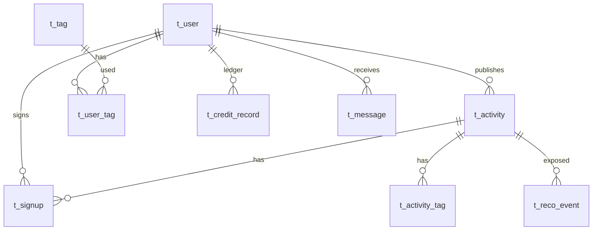
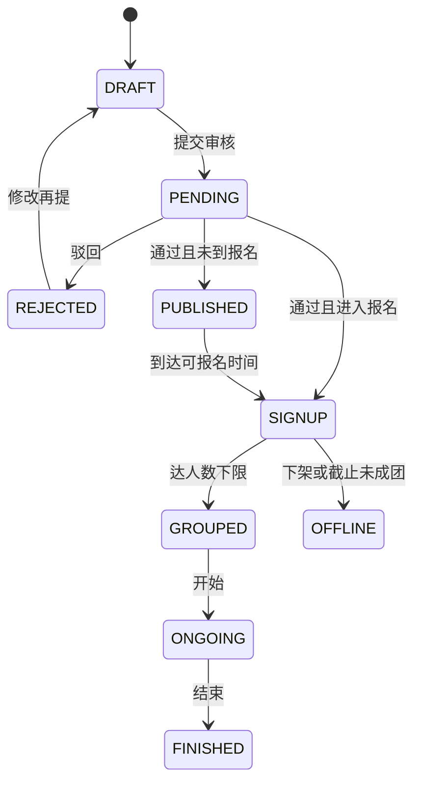

# 数据模型 v1.0

MySQL 8、utf8mb4。公共字段：`id BIGINT PK`、`create_time`、`update_time`、`deleted`。状态用字符串。共 16 张业务表 + `t_user_similarity` 供 UserCF。

| 表 | 说明 |
| --- | --- |
| t_user | openid、phone 可空唯一；credit_score 0–100；role |
| t_tag / t_user_tag / t_activity_tag | 标签字典与多对多 |
| t_activity | publisher_id、人数上下限、时间地点、status |
| t_signup | UNIQUE(activity_id, user_id) |
| t_credit_record | 只插入 |
| t_message | 站内信 |
| t_favorite | UNIQUE(user_id, activity_id) |
| t_review | 活动互评 |
| t_report | 举报工单 |
| t_blacklist | 禁发布/禁报名 |
| t_sensitive_word | 敏感词 |
| t_user_feature | 推荐画像 |
| t_reco_event | 埋点 |
| t_admin_op_log | 后台日志 |
| t_subscribe_log | 订阅消息发送 |
| t_user_similarity | UserCF 相似用户 |

管理员使用 `t_user.role`，口令 BCrypt。

报名状态：`APPLYING|APPROVED|WAITLIST|REJECTED|CANCELED|NOSHOW|DONE`。
