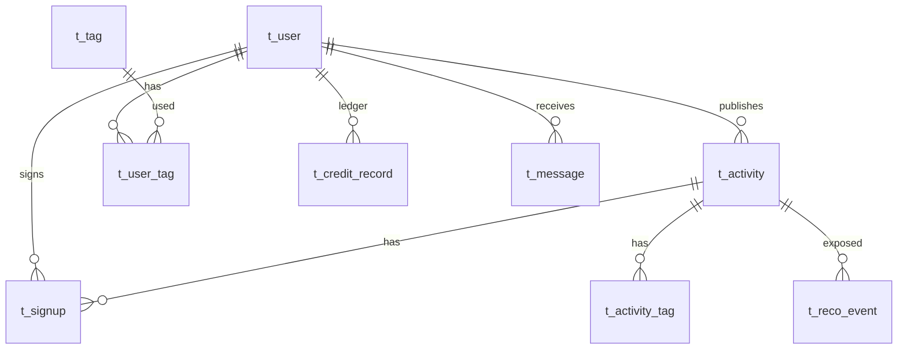
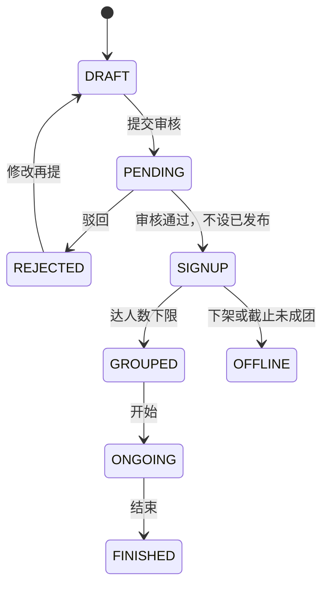

# 数据模型 v1.0

MySQL 8、utf8mb4。公共字段：`id BIGINT PK`、`create_time`、`update_time`、`deleted`。状态用字符串。共 16 张业务表。`t_user_similarity` 只给以后的协同过滤离线刷新；第一圈可以没有数据，没有相似度时跳过该因子。

| 表 | 说明 |
| --- | --- |
| t_user | campus_id 唯一（学号/工号）；school_email 可空唯一；openid、phone 可空唯一；password_hash；credit_score 0–100；role；affiliation=`SHU` 或 `DEMO` |
| t_tag / t_user_tag / t_activity_tag | 标签字典与多对多 |
| t_activity | publisher_id、人数上下限、时间地点、status |
| t_signup | UNIQUE(activity_id, user_id) |
| t_credit_record | 只插入 |
| t_message | 站内信 |
| t_favorite | UNIQUE(user_id, activity_id) |
| t_review | 活动互评 |
| t_report | 举报工单 |
| t_blacklist | 禁发布/禁报名 |
| t_sensitive_word | 敏感词 |
| t_user_feature | 推荐画像 |
| t_reco_event | 埋点 |
| t_admin_op_log | 后台日志 |
| t_subscribe_log | 订阅消息发送 |
| t_user_similarity | 协同过滤相似用户，第一圈可空 |

管理员使用 `t_user.role`，口令 BCrypt。

报名状态：`APPLYING|APPROVED|WAITLIST|REJECTED|CANCELED|NOSHOW|DONE|UNSETTLED`。未打开「需要确认」时直接 `APPROVED`。打开后先 `APPLYING`，不占正式名额。结束后为 `DONE`、`NOSHOW` 或 `UNSETTLED`。逾期未确认保持 `UNSETTLED`，不自动变成 `DONE`。`SIGNUP` 和仍有名额的 `GROUPED` 都可以报名。
