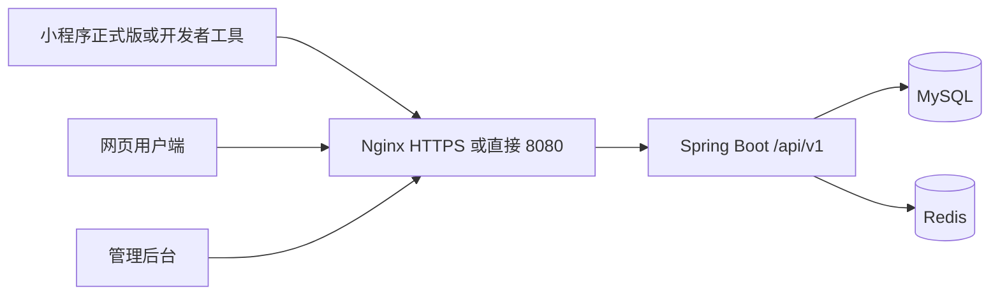

# 落地部署：同一后端，三种用法

小程序和网页（用户端、管理后台）只连接 **同一个 Spring Boot**。差别只在前端怎么打开，不在业务规则。F 提供 Compose 与 Nginx；E 配置小程序服务器域名；密钥放环境变量。

三个前端的 `apiBase` 指向同一主机，例如 `https://api.example.com/api/v1` 或开发时 `http://192.168.x.x:8080/api/v1`。

## 1. 一般情况（课程默认，优先保证能答辩）

不依赖备案、不依赖小程序正式发布。

| 端 | 怎么用 |
| --- | --- |
| 后端 | 本机或一台云主机，在 `deploy/` 执行 `docker compose up mysql redis`；API 能编译后再加 `--profile app`。端口 8080。 |
| 网页用户端 / 后台 | Vite 开发服务器或 Nginx 静态资源。浏览器打开 `http://服务器IP:80` 或 `http://localhost:5173`。同学用同一局域网地址即可。 |
| 小程序 | 微信开发者工具导入项目；详情里勾选「不校验合法域名」。手机扫工具里的预览/调试二维码。`app.js` 里 `apiBase` 填电脑的局域网 IP（手机和电脑同一 Wi-Fi）或云主机 IP。 |

注意：真机预览时，手机访问的是电脑 IP，防火墙要放行 8080/80。不要用 `localhost`，那是手机自己。开发阶段 CORS 允许该 IP；小程序 request 不走浏览器 CORS，但仍要这个 IP 能连上后端。

这条路径足够：注册（账号密码或开发者工具里的测试号登录）、发活动、报名、后台审核。

## 2. 较好情况（有云主机、暂未备案）

买轻量服务器，网页用 `http://公网IP` 或云厂商临时域名。小程序仍用开发者工具扫码，`apiBase` 改为公网 IP。适合给老师远程点网页；小程序正式版 **不能** 把未备案 IP 配进 request 合法域名，所以小程序继续走工具预览。

## 3. 最好情况（域名 + 备案 + 小程序可正式注册）

1. 购买域名，在云厂商完成 ICP 备案（通常数周，开题后尽早提交，不挡编码）。
2. HTTPS（Nginx + 证书），API 如 `https://api.你的域名.com`。
3. 微信公众平台：服务器域名填该 HTTPS 地址；个人主体可做登录，不做支付。
4. 小程序提交审核、发布后，同学可在微信里搜索打开并注册登录。
5. 网页同样走该域名，例如 `https://www.你的域名.com` 用户端、`https://admin.你的域名.com` 后台。

备案未下来之前，一直用第 1 节，不要停开发。订阅消息、正式微信登录在拿到 AppId 后再接通；未接通时用学号 + 本平台密码（首次学校邮箱验证码）登录，Web 与小程序共用 `/auth/login`。邮箱验证码可用任意可发信的 SMTP，密钥进环境变量。

## 4. 配置项（三套环境同一套代码）

| 变量 | 含义 |
| --- | --- |
| `APP_BASE_URL` | 对外 API 根，不含尾斜杠 |
| `CORS_ORIGINS` | 网页 origin 列表，不能用 `*` 加 Cookie |
| `WX_APPID` / `WX_SECRET` | 仅环境变量 |
| `JWT_SECRET` | 仅环境变量 |
| `MAIL_*` | 发验证码的 SMTP，仅环境变量 |
| `MYSQL_*` / `REDIS_*` | Compose 内网 |

小程序：`config.js` 分 `develop | trial | release` 三个 `apiBase`。Web：`.env.development` / `.env.production` 的 `VITE_API_BASE`。禁止把密钥写进仓库。

## 5. 分工与验收

- F：Compose、Nginx、部署说明、网页生产构建。
- E：开发者工具工程、预览二维码步骤、正式版域名清单。
- A：学号登录在小程序、网页行为一致（同一用户表）；微信未绑定学号不能报名。
- 答辩最低标准：网页公网或局域网可点；小程序开发者工具扫码可走通主路径；两者打到同一后端（用同一测试账号在两端能看到同一条活动）。
