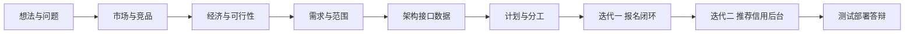

# 过程、可行性、对比与风险

本课程要的是软件从想法走到可维护系统的全过程。编码是最后一步，不是第一周的事。本文把立项时该做、却容易被“先写代码”跳过的部分收在一起。

## 1. 过程怎么排

采用 **增量迭代**：前面把问题、市场、经济、需求、接口和风险说清楚，后面两轮才加功能。

| 周 | 过程活动 | 开发占比 |
| --- | --- | --- |
| 1–2 | 问题定义、调研、需求、契约 | 几乎不写业务代码 |
| 3–4 | 架构、库表、原型、空工程 | 脚手架，不算功能完成 |
| 5–6 | 第一次把主路径做通 | 开始开发 |
| 7–8 | 亮点与治理 | 开发 |
| 9–10 | 测试、部署、材料 | 改缺陷，不加范围 |

变更走申请：影响接口或范围的，先改本仓库文档再改代码。这是为了答辩时能讲清“为什么现在这样”，而不是只展示页面。

和瀑布的差别：不是把十周锁死成一次交付，而是两次增量；和“先写着再说”的差别：增量从第 5 周才开始，前面四周的产出是文档和契约，不是半成品页面。

## 2. 可行性（设计阶段四问）

**技术可行。** JDK 17 + Spring Boot 3、Vue 3、微信小程序都是课程和网上资料能覆盖的栈。难点是并发报名和推荐，都有经典做法（原子计数 + 唯一索引；可解释加权 + 降级），不依赖未掌握的深度学习。结论：可行，推荐按“先热门后六因子”降风险。

**经济可行。** 见 [经济分析](07-economic-analysis.md)。十周现金很低；长期靠 B 端服务而不是弹窗广告。

**操作/组织可行。** 六人、四后两端，模块边界已经按开发方案切开。每周五例会三条剧本（成团、满员、敏感词）。小程序审核若慢，网页同一后端可演示。结论：可行，单点风险用 backup。

**法律与合规可行。** 本期无支付、无持续定位、最小化采集、脱敏、注销。个人主体小程序不做交友类目承诺。用户协议声明线下安全自负。身份：**不收集学校统一认证密码**；用学校邮箱域证明本校师生。短信和 SSO 见 [校园身份](16-campus-identity.md)。结论：课设范围可行；以后商家核销必须换企业主体并重做合规。

## 3. 方案对比（设计时必须做的选择）

软件产品在写第一行业务代码前，要把“做还是不做什么、用什么形态做”写成可辩护的选择。下面四组是本项目已经定下来的。

### 3.1 做活动工具，还是做校园社交

| | 校园社交（搭搭校园那条路） | 活动工具（我们） |
| --- | --- | --- |
| 对象 | 人 | 一场局 |
| 成功标准 | 聊天、匹配、停留时长 | 成团、到场 |
| 审核类目 | 容易落到交友 18+ | 可按工具/生活服务准备材料 |
| 十周风险 | 墙、树洞、闪聊做不完 | 报名闭环能演示 |
| 长期变现 | 流量广告、会员 | 社团/学校工具费 |

选定活动工具。市场调研第 3 节是依据。

### 3.2 自研，还是套活动行 / 互动吧 / 表白墙源码

| | 直接用互动吧或活动行 | 买校园墙源码改 | 自研本期范围 |
| --- | --- | --- | --- |
| 速度 | 最快 | 快 | 慢，但课设要过程 |
| 本校约束 | 无学号校区 | 有社区，组队弱 | 校区、名额、信用自有 |
| 代码量与过程分 | 几乎没有工程过程 | 改别人的盘 | 契约、状态机、测试都是自己的 |
| 以后要收费 | 给平台交会员 | 受源码授权绑 | 资产在自己库里 |

选定自研。课设验收的是过程和质量，不是谁先上线一个报名页。

### 3.3 小程序 + Web，还是只做 App

| | 只做 App | 只做小程序 | 小程序 + Web 同后端（我们） |
| --- | --- | --- | --- |
| 安装 | 要下载 | 微信里即开 | 两端 |
| 审核 | 应用商店 | 微信类目 | 小程序失败仍可用网页答辩 |
| 课设工作量 | 两端原生太重 | 后台不好做 | Vue 后台自然落在 Web |
| 对照 | Soul、搭搭校园 | 狐友把校园圈放进微信小程序，产品本身还有 App | 互动吧、活动行也是多端 |

选定小程序给同学用、Web 给同学和答辩兜底、管理后台在 Web。不自研 iOS/Android。

### 3.4 校园身份：学校密码、邮箱码、还是自己发短信

| | 收学校密码 | 学校邮箱验证码（V1.0） | 自己发短信 | 官方 SSO |
| --- | --- | --- | --- | --- |
| 能否证明上大人 | 看似能，实则我们无权验 | 能（域在 shu.edu.cn 等） | 只能证明手机 | 能，且密码打在学校页面 |
| 课设十周 | 禁止 | 能做 | 个人基本拿不到签名 | 去申请，不挡编码 |
| 老师若追问 | 钓鱼风险 | 打开信息办邮箱说明 | 打开腾讯云签名规则 | 打开信息办申请页 |

选定邮箱验证码。申请 SSO 作为加分，短信不做答辩依赖。

### 3.5 推荐：规则打分，还是一上来协同过滤

没有真实点击时，UserCF 只能在造数上好看。选定：第 6 周热门榜必须能用，六因子加权可解释，UserCF 作为可裁剪亮点。降级开关属于交付物，不是失败态。

## 4. SWOT（和竞品对照后的策略）

| | 有利 | 不利 |
| --- | --- | --- |
| 内部 | 切口清楚：活动而非交友；信用和名额是差异点；四端工作量够课设 | 没有现成用户；十周做不了全国；推荐没有真实点击数据 |
| 外部 | 搭子行为已被调查证实；竞品把组队当附属或做成城市售票 | 微信群习惯极强；搭搭校园等已占“找搭子”心智且偏社交；冷启动难 |

策略：不和搭搭校园比谁更像社交，不和青藤谷比谁服务更多，不和互动吧比谁票务更全；把“今晚本区这场局”做到可以演示、可以讲规则。

## 5. 风险登记

| 编号 | 风险 | 可能 | 影响 | 应对 |
| --- | --- | --- | --- | --- |
| R-01 | 推荐复杂度拖死进度 | 中 | 高 | 第 6 周先热门榜，再加因子；一键降级 |
| R-02 | 代码量不够 10000 | 中 | 高 | 每周 cloc；测试和 DTO 算进对应模块，禁止空方法凑行 |
| R-03 | 接口各写各的 | 高 | 中 | 契约先于代码，PR 对路径 |
| R-04 | 小程序审核失败或类目被判交友 | 中 | 高 | 叙事锁在活动工具；网页完整演示；开发者工具扫码 |
| R-05 | 隐私被追问 | 中 | 高 | 最小化、脱敏、注销、不爬教务 |
| R-06 | 有人时间不够 | 高 | 中 | 模块 A/B 角，例会暴露 |
| R-07 | 并发超员 | 低 | 高 | Redis + 唯一索引 + 并发测试 |
| R-08 | 文档和代码脱节 | 中 | 中 | 改接口先改本仓 04 |
| R-09 | 做成交友被老师/审核卡住 | 中 | 高 | 不做闪聊墙；活动对象化 |
| R-10 | 以后只靠广告 | 低（课设内）/高（若扩张） | 高 | 经济分析里的分层变现，广告不当主收入 |
| R-11 | 冷启动没有可报的局 | 高 | 高 | 种子用户剧本：组员先发晚饭/自习/跑步；第 2 周问卷找愿意发的人 |
| R-12 | 线下安全事件 | 低 | 高 | 协议写明平台不做担保；举报、拉黑；不做持续定位 |
| R-13 | 范围膨胀（外卖、IM、支付） | 中 | 高 | 范围表写死；变更先改愿景再改代码 |
| R-14 | 密钥进 Git | 中 | 高 | .gitignore；泄露先作废再处理历史 |
| R-15 | 演示环境当天起不来 | 中 | 高 | Compose 一键；F 保留本地回放视频 |
| R-16 | 页面收集学校统一认证密码 | 中 | 高 | 文案禁止；不做模拟登录；SSO 未批就用邮箱码 |
| R-17 | 短信签名审不过 | 高 | 低（若当依赖则高） | V1 只用邮箱；短信不进 P0 |

## 6. 质量与变更（开发开始以后仍然算过程，不算“先写了再说”）

- 接口变更：先 PR 改 `04-api-contract.md`，再改实现。
- 范围变更：先改愿景/PRD 的范围内表，全组同意。
- 合并：短分支 + 一人复核，见 [协作](09-github-collaboration.md)。
- 完成：P0 测过才能进迭代二装饰；推荐挂了必须能降级。

## 7. 和“先写代码”的课设比，多了什么

| 活动 | 本项目放哪 | 若省略会怎样 |
| --- | --- | --- |
| 问题与范围 | 愿景 / PRD | 十周做成社交大盘 |
| 市场与竞品 | 06 | 答辩讲不出和搭搭校园、互动吧的差别 |
| 经济与后续 | 07 | 只能说“我们是课设”，被问盈利会空 |
| 可行性、方案对比与风险 | 本文 | 出问题没有预案，也说不清为什么不套现成平台 |
| 校园身份 | 16 | 把学校密码填进课设页面，或答辩讲不清验证码权力 |
| 接口与数据 | 04 / 11 | 前后端对不上 |
| 分工与批次 | 05 / 10 | 两人扛推荐 |
| 实现 | 第 5 周才大规模开始 | — |
| 测试部署 | 9–10 周 | 演示不可复现 |
